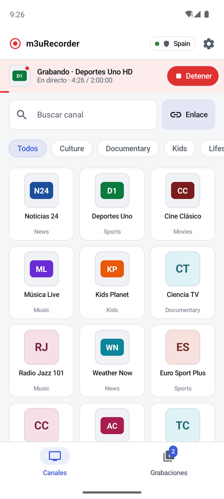
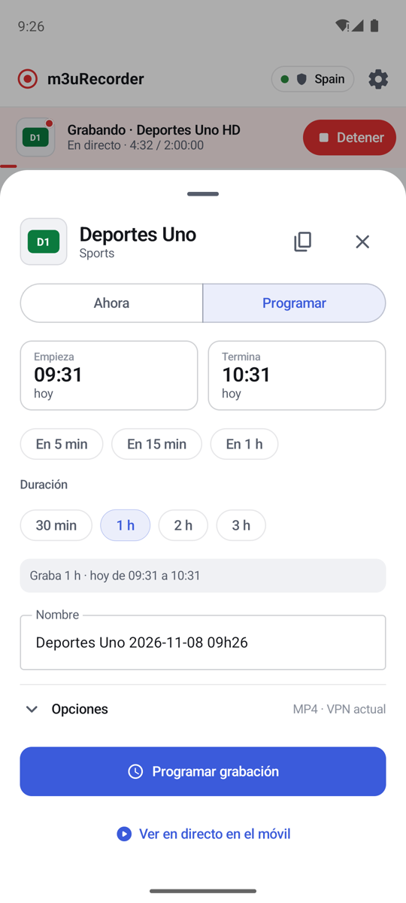
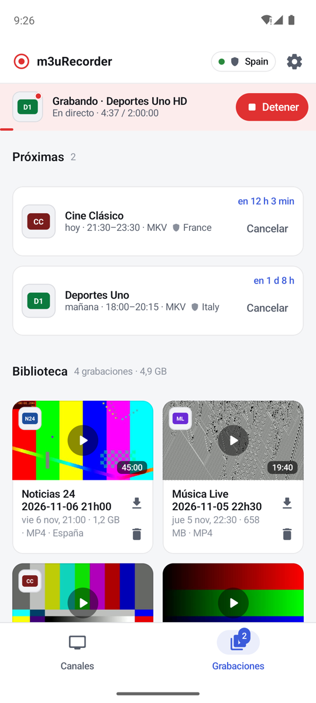
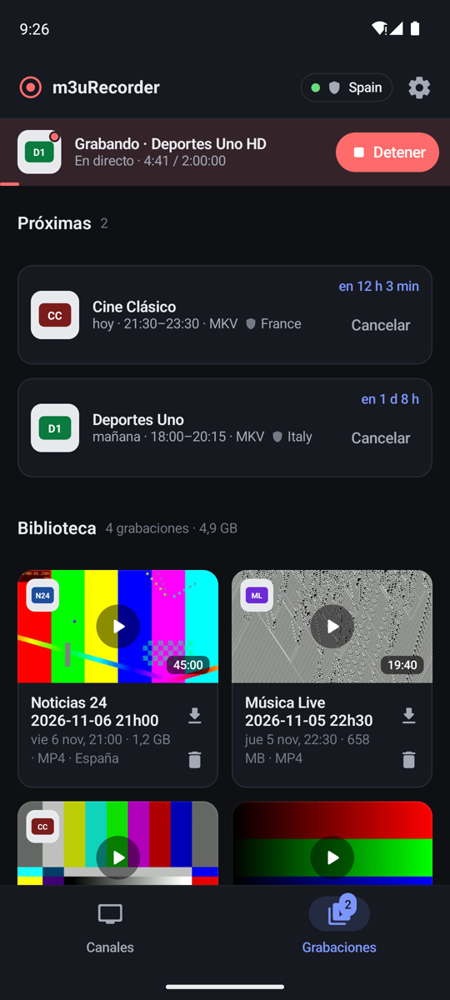
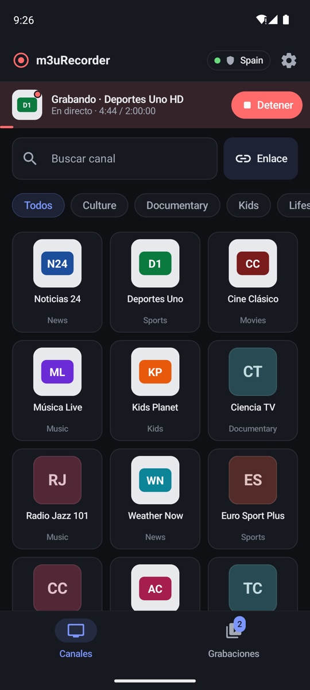

<h1 align="center">m3uRecorder para Android</h1>

<p align="center">
  App complementaria de <a href="https://github.com/allopism/m3uRecorder">m3uRecorder</a>, el grabador autoalojado de emisiones en directo.<br>
  Explora canales, graba o programa desde el móvil y mira tus grabaciones — con una notificación que cuenta atrás mientras graba.
</p>

<p align="center">
  <a href="https://github.com/allopism/m3uRecorder-android/actions/workflows/ci.yml"></a>
  <a href="https://github.com/allopism/m3uRecorder-android/releases/latest"></a>
  <a href="LICENSE"></a>
  
  
</p>

<p align="center">
  <a href="README.md">English</a> · <b>Español</b>
</p>

<p align="center">
  
  
  
  
  
</p>

## Funciones

- **Canales** con su logo (PNG o SVG) o un monograma de color, búsqueda y filtro por categoría.
- **Un panel para grabar ahora o programar**, el mismo flujo que la web: duraciones rápidas, hora de
  inicio y fin, resumen en una frase, formato de salida y país de la VPN.
- **Tiene en cuenta los cambios de hora.** Si la hora elegida ocurre dos veces (finales de octubre),
  eliges la primera o la segunda; si no existe (finales de marzo), la app avisa. Las duraciones son
  tiempo real.
- **Grabaciones:** próximas programadas con cuenta atrás, biblioteca con miniaturas y programaciones
  anteriores.
- **Reproductor** con Media3/ExoPlayer: MKV, MP4, TS y HLS, cambio de pista de audio, pantalla
  completa o abrir el archivo en otra app (VLC…) con un enlace firmado.
- **Notificación "Grabando"** con cuenta atrás movida por el sistema y botón Detener — también
  aparece en las programadas con la app cerrada.
- **Tema claro, oscuro o del sistema**, con los mismos colores que la web. En móvil, vertical; en
  tablet gira.
- **Token**: envía `Authorization: Bearer` solo a tu servidor, nunca a las URL de emisión de terceros.

## Primeros pasos

1. Pon en marcha el [servidor m3uRecorder](https://github.com/allopism/m3uRecorder).
2. Descarga la APK de [Releases](https://github.com/allopism/m3uRecorder-android/releases/latest)
   e instálala (Android 9 o superior).
3. Al abrirla por primera vez, escribe la dirección del servidor (por ejemplo `192.168.1.10:9984`)
   y, si el servidor usa `APP_TOKEN`, el token. Pulsa **Probar conexión** y guarda.

El servidor está pensado para quedarse en tu red local: desde fuera, conéctate a casa con una VPN
(WireGuard, por ejemplo). La app solo consulta el servidor mientras está visible, y en segundo plano
solo con Wi-Fi, Ethernet o una conexión VPN.

## Notas de diseño

<details>
<summary>La notificación "Grabando" sin servicio en primer plano</summary>

Desde Android 12 no se puede arrancar un servicio en primer plano desde segundo plano, y consultar
cada pocos segundos gasta batería. En su lugar, la app publica **una notificación normal** con
`setUsesChronometer` + `setChronometerCountDown`, así que el propio sistema dibuja la cuenta atrás,
y `setTimeoutAfter` la quita al terminar. La app se entera de las grabaciones:

- con la app visible, por su consulta de estado (que se detiene sola al pasar a segundo plano gracias
  a `repeatOnLifecycle`);
- en las programadas, por una alarma exacta local a la hora de inicio (la programación ya se
  conoce), que consulta al servidor si está accesible;
- y por una comprobación periódica de WorkManager (cada 15 min, solo con Wi-Fi o VPN).

Los avisos de "terminada" o "fallida" los envía el servidor por Telegram.

</details>

<details>
<summary>Arquitectura</summary>

```
app/src/main/java/com/m3urecorder/app/
├── MainActivity.kt                 entrada, enlaces compartidos, orientación
├── data/
│   ├── ApiClient.kt                cliente REST (HttpURLConnection + org.json), errores legibles
│   ├── AppPrefs.kt                 dirección del servidor, token, preferencias
│   └── Models.kt
├── service/
│   └── RecordingNotifications.kt   notificación con cuenta atrás, alarmas, WorkManager
├── ui/
│   ├── MainViewModel.kt            todo el estado y las acciones (las pantallas solo pintan)
│   ├── AppScreen.kt                cabecera, barra "Grabando", navegación
│   ├── VideoPlayerDialog.kt        reproductor Media3
│   ├── screens/                    Canales, Grabaciones, panel de grabar, Ajustes
│   ├── components/                 logos/monogramas (Coil), etiquetas, chips, barra en vivo
│   └── theme/                      colores claro/oscuro compartidos con la web
└── util/                           formatos, zonas horarias y cambios de hora
```

Tecnologías: Kotlin 2.4 · Jetpack Compose (Material 3) · Lifecycle/ViewModel · Media3 ExoPlayer ·
Coil 3 · WorkManager · R8 (APK de release ≈ 5 MB).

</details>

## Compilar desde el código

Requisitos: Android Studio (o JDK 17+) y el SDK de Android (compile SDK 37).

```bash
./gradlew test             # pruebas unitarias (formatos, zonas horarias, cambios de hora)
./gradlew assembleDebug    # app/build/outputs/apk/debug/
./gradlew assembleRelease  # app/build/outputs/apk/release/
```

La versión release se firma con la clave indicada en un archivo local `keystore.properties` (que no
está en el repositorio):

```properties
storeFile=/ruta/a/tu-release.jks
storePassword=…
keyAlias=…
keyPassword=…
```

Sin ese archivo, la release se firma con la clave de depuración, para que cualquiera pueda
compilarla y probarla.

## Uso responsable

Como el servidor, esta app es para emisiones **a las que tienes derecho a acceder**. No incluye ni
proporciona ningún contenido ni lista de canales.

## Licencia

[MIT](LICENSE) © 2026 Andrés Llopis
