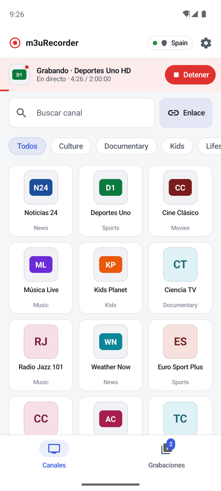
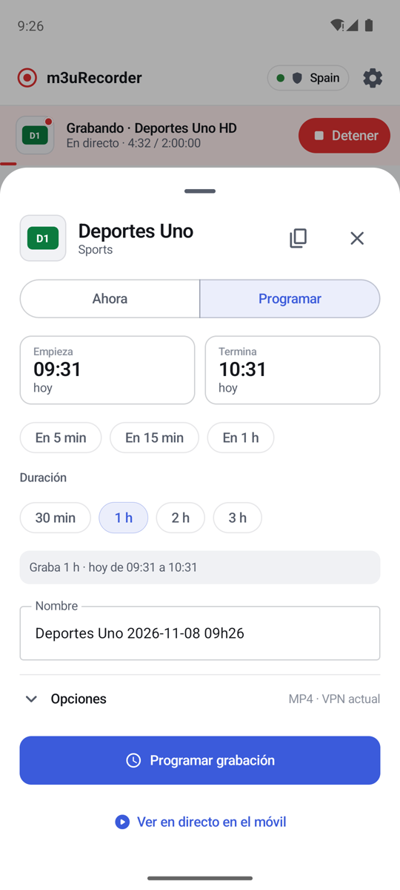
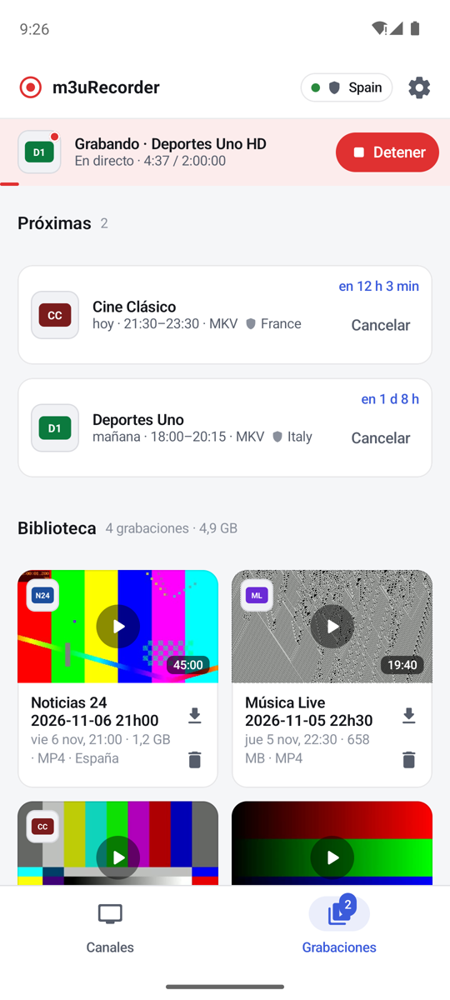
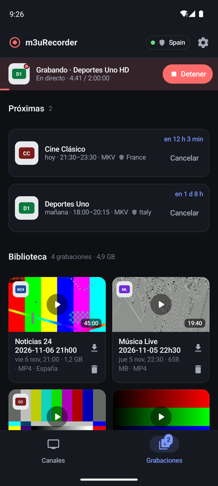
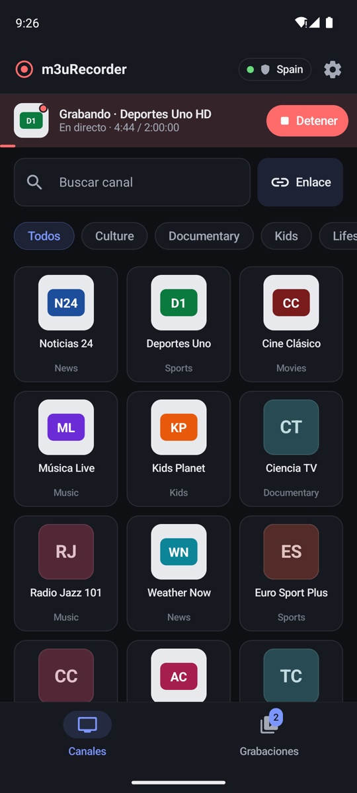

<h1 align="center">m3uRecorder for Android</h1>

<p align="center">
  Companion app for <a href="https://github.com/allopism/m3uRecorder">m3uRecorder</a>, the self-hosted DVR for live streams.<br>
  Browse channels, record or schedule from your phone, and watch your recordings — with a notification that counts down while recording.
</p>

<p align="center">
  <a href="https://github.com/allopism/m3uRecorder-android/actions/workflows/ci.yml"></a>
  <a href="https://github.com/allopism/m3uRecorder-android/releases/latest"></a>
  <a href="LICENSE"></a>
  
  
</p>

<p align="center">
  <b>English</b> · <a href="README.es.md">Español</a>
</p>

<p align="center">
  
  
  
  
  
</p>

## Features

- **Channels** with their logos (PNG or SVG) or a colored monogram, search and category filters.
- **One sheet to record now or schedule**, the same flow as the web UI: quick durations, start/end
  pickers, a one-line summary, output format and VPN country.
- **Daylight-saving aware.** If the chosen time happens twice (end of October), you pick the first
  or the second one; if it does not exist (end of March) the app warns you. Durations are real time.
- **Recordings:** upcoming schedules with a live countdown, a library with thumbnails, and past
  schedules.
- **Player** based on Media3/ExoPlayer: MKV, MP4, TS and HLS, audio-track switching, full screen,
  or open the file in another app (VLC…) through a signed link.
- **"Recording now" notification** with a system-driven countdown and a Stop button — it also
  appears for scheduled recordings while the app is closed.
- **Light, dark or system theme**, the same colors as the web UI. Phones in portrait; tablets rotate.
- **Token support**: sends `Authorization: Bearer` only to your own server, never to third-party
  stream URLs.

## Getting started

1. Run the [m3uRecorder server](https://github.com/allopism/m3uRecorder).
2. Download the APK from [Releases](https://github.com/allopism/m3uRecorder-android/releases/latest)
   and install it (Android 9 or newer).
3. On first launch, enter the server address (for example `192.168.1.10:9984`) and, if the server
   uses `APP_TOKEN`, the token. Tap **Probar conexión** (test connection) and save — the app UI is in Spanish.

The server is meant to stay on your local network: from outside, connect to your home through a VPN
(WireGuard, for example). The app only polls the server while it is visible, and in the background
only on Wi-Fi, Ethernet or a VPN connection.

## Design notes

<details>
<summary>The "recording now" notification without a foreground service</summary>

Android 12+ does not allow starting a foreground service from the background, and polling every few
seconds drains the battery. Instead, the app posts **one regular notification** with
`setUsesChronometer` + `setChronometerCountDown`, so the system itself draws the countdown, and
`setTimeoutAfter` removes it when the recording ends. The app learns about recordings:

- while visible, from its status polling (stopped automatically when the app goes to the background
  via `repeatOnLifecycle`);
- for scheduled recordings, from a local exact alarm at the start time (the schedule is already
  known), which checks the server if it is reachable;
- and from a periodic WorkManager check (every 15 min, only on Wi-Fi/VPN).

"Finished" or "failed" alerts are left to the server's Telegram notifications.

</details>

<details>
<summary>Architecture</summary>

```
app/src/main/java/com/m3urecorder/app/
├── MainActivity.kt                 entry point, share intent, orientation
├── data/
│   ├── ApiClient.kt                REST client (HttpURLConnection + org.json), readable errors
│   ├── AppPrefs.kt                 server address, token, preferences
│   └── Models.kt
├── service/
│   └── RecordingNotifications.kt   countdown notification, schedule alarms, WorkManager
├── ui/
│   ├── MainViewModel.kt            all state and actions (screens only render)
│   ├── AppScreen.kt                top bar, live bar, navigation
│   ├── VideoPlayerDialog.kt        Media3 player
│   ├── screens/                    Channels, Recordings, RecordSheet, Settings
│   ├── components/                 logos/monograms (Coil), tags, chips, live bar
│   └── theme/                      light/dark tokens shared with the web UI
└── util/                           formatting, time zones and DST transitions
```

Stack: Kotlin 2.4 · Jetpack Compose (Material 3) · Lifecycle/ViewModel · Media3 ExoPlayer ·
Coil 3 · WorkManager · R8 (release APK ≈ 5 MB).

</details>

## Building from source

Requirements: Android Studio (or JDK 17+) and the Android SDK (compile SDK 37).

```bash
./gradlew test             # unit tests (formatting, time zones, DST)
./gradlew assembleDebug    # app/build/outputs/apk/debug/
./gradlew assembleRelease  # app/build/outputs/apk/release/
```

Release builds are signed with the key described in a local `keystore.properties` file (not in the
repository):

```properties
storeFile=/path/to/your-release.jks
storePassword=…
keyAlias=…
keyPassword=…
```

Without that file the release build falls back to the debug key, so anyone can build and try it.

## Responsible use

Like the server, this app is meant for streams **you are allowed to access**. It does not include
or provide any content or channel list.

## License

[MIT](LICENSE) © 2026 Andrés Llopis
